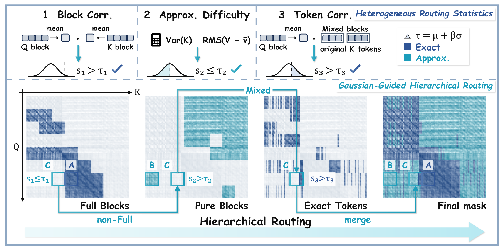

<h1 align="center">Sol³: Accelerating Video Diffusion for Free via Hierarchical Sparse Attention Routing</h1>

<p align="center">
  Guoxin Fan<sup>1,2,*</sup>, Weilun Feng<sup>1,2,*</sup>, Chuanguang Yang<sup>1,†</sup>, Mingqiang Wu<sup>1,2</sup>, Xiaokun Liu<sup>1,2</sup>,<br>
  Jitao Lu<sup>1,2</sup>, Zhulin An<sup>1</sup>, Libo Huang<sup>1</sup>, Boyu Diao<sup>1</sup>, Di Gao<sup>3</sup>, Yongjun Xu<sup>1,4</sup>
</p>

<p align="center">
  <sup>1</sup>State Key Laboratory of AI Safety, Institute of Computing Technology, Chinese Academy of Sciences<br>
  <sup>2</sup>University of Chinese Academy of Sciences<br>
  <sup>3</sup>Hangzhou Institute for Advanced Study, University of the Chinese Academy of Sciences<br>
  <sup>4</sup>Xiamen Institute of Data Intelligence, Xiamen, China<br>
  <sup>*</sup>Equal contribution &nbsp;·&nbsp; <sup>†</sup>Corresponding author
</p>

<p align="center">
  <a href="https://fofgofx.github.io/sol3/"></a>
  <a href="https://arxiv.org/abs/2611.32562"></a>
  <a href="LICENSE"></a>
</p>

<p align="center">
  <a href="assets/method.png"></a>
</p>

**Sol³** is a training-free sparse attention method for video diffusion models. It uses block relevance and variation in keys and values to decide where a block-level approximation is sufficient. For blocks that need a closer look, Sol³ selects individual tokens for exact attention and represents the remaining tokens with a weighted approximation. On Wan2.2 image-to-video generation, Sol³ achieves up to **3.07× attention speedup** over FlashAttention.

## 🔥 News

- **[2026/11/28]** Added a ComfyUI integration for MiniMax H3 with a single-phase pi-H3 example workflow. [Install Sol³ from source](#quick-start) in the Python environment used by ComfyUI, then follow the [ComfyUI setup guide](integrations/comfyui/README.md).
- **[2026/11/24]** Sol³ v0.1.0 includes the standalone attention operator and source integrations for six models.

<a id="quick-start"></a>

## 🚀 Quick Start

### 📋 Requirements

- Python 3.10 or later
- CUDA-enabled PyTorch 2.5.1 or later and Triton 3.1 or later
- An NVIDIA GPU with compute capability 8.0 (SM80) or 12.0 (SM120)
- FlashInfer 0.3.1 for SM80, installed by the `sm80` extra below

We tested the standalone operator on NVIDIA A800 (SM80) with PyTorch 2.5.1+cu124, Triton 3.1.0, and FlashInfer 0.3.1.
On NVIDIA RTX PRO 6000 Blackwell (SM120), we tested with PyTorch 2.10.0+cu128 and Triton 3.6.0.

### 📦 Installation

Install a CUDA-enabled PyTorch build compatible with your GPU and driver. From the root of this repository, run the command for your GPU.

**SM80 (NVIDIA A800)**

```bash
python -m pip install '.[sm80]'
```

**SM120 (NVIDIA RTX PRO 6000 Blackwell)**

```bash
python -m pip install .
```

### ⚙️ Backend Dispatch

`sol3_attn` selects the backend from the device of the query tensor. Both backends compile Triton kernels on first use.

| GPU architecture | Tested GPU | Attention backend |
| --- | --- | --- |
| SM80 | NVIDIA A800 | Triton routing and representative-term merge, with FlashInfer for exact attention |
| SM120 | NVIDIA RTX PRO 6000 Blackwell | Triton kernel that accumulates exact and representative terms together |

> [!NOTE]
> On SM80, model-specific optimizations can yield higher attention speedups than those reported in the main text of the paper. For better fidelity, try using full attention for more initial denoising steps.

### 💻 Usage

The core operator computes forward-only, bidirectional attention on contiguous BF16 tensors. Supply Q, K and V on the same CUDA device in `[batch, tokens, heads, head_dim]` order, with batch size 1 and head dimension 128.

```python
import torch
from sol3_attn import sol3_attn

shape = (1, 16_385, 4, 128)
q, k, v = [torch.randn(shape, device="cuda", dtype=torch.bfloat16) for _ in range(3)]

out = sol3_attn(q, k, v)
assert out.shape == q.shape and out.dtype == q.dtype and out.device == q.device
```

The backend switches to its long-sequence tuning at 16,385 tokens.

**Joint attention with a text or audio prefix.** If the first 37 tokens are conditioning tokens and video tokens follow them, pass the prefix length:

```python
out = sol3_attn(q, k, v, prefix_tokens=37)
```

Prefix queries use dense attention over the full sequence. Video queries attend exactly to every 64-token KV block that overlaps the prefix. The default dense implementation is PyTorch SDPA. A host can supply its own `dense(q_prefix, k, v)` callback returning a tensor with the query’s shape, dtype and device.

**Releasing the workspace.** At a model or job boundary, you can free cached scratch buffers:

```python
from sol3_attn import release_workspace

release_workspace()
```

### 🧩 Model Integrations

Install the core package in the model’s inference environment. The six adapters ship as source with the repository and source archive. From the repository root, make them available to your launcher:

```bash
export PYTHONPATH="$PWD/integrations${PYTHONPATH:+:$PYTHONPATH}"
```

| Model | Preset | GPU architecture | Where Sol³ runs |
| --- | --- | --- | --- |
| [Wan2.2](integrations/sol3_integrations/wan22.py) | `wan` | SM80 | Video self-attention in both high- and low-noise experts |
| [HunyuanVideo](integrations/sol3_integrations/hunyuan_video.py) | `hy` | SM80 | Joint attention with a protected text suffix |
| [SANA-WM](integrations/sol3_integrations/sana_wm.py) | `sana` | SM80 | Stage 2 Refiner video attention, preserving the native anchor |
| [LTX-2.5](integrations/sol3_integrations/ltx25.py) | `ltx` | SM80 | Stage 1 video self-attention after the model’s capacity check |
| [H3-Base](integrations/sol3_integrations/h3_base.py) | `h3` | SM80 | Joint attention with a protected conditioning prefix |
| [FastH3](integrations/sol3_integrations/fasth3.py) | `fast` | SM120 | Joint attention with protected text and audio prefixes |

Use `get_preset` when your host needs a reference configuration. For H3-Base, load it once and pass the conditioning prefix length from the current input on each sparse call.

```python
from sol3_attn import get_preset, sol3_attn_with_route

preset = get_preset("h3")
out, route = sol3_attn_with_route(
    q, k, v, profile="h3", config=preset["kernel_config"],
    sink_start=0, sink_tokens=prefix_tokens, dense=dense_attention,
)
```

The host model controls dense warmup, layer selection, token layout and masking. The [integration guide](integrations/README.md) shows how to attach an adapter to an existing sparse attention call and verify that the model used it during generation.

## ✅ To-do

- [x] Add ComfyUI integration for MiniMax H3.

## ⭐ Star History

<p align="center">
  <a href="https://www.star-history.com/?repos=FofGofx%2Fsol3&amp;type=date&amp;legend=top-left">
    <picture>
      <source media="(prefers-color-scheme: dark)" srcset="https://api.star-history.com/chart?repos=FofGofx/sol3&amp;type=date&amp;theme=dark&amp;legend=top-left">
      <source media="(prefers-color-scheme: light)" srcset="https://api.star-history.com/chart?repos=FofGofx/sol3&amp;type=date&amp;legend=top-left">
      
    </picture>
  </a>
</p>

## 🤝 Acknowledgements

We thank the authors of [Sol-Attn](https://github.com/NVlabs/Sana/tree/sol-engine/techniques/sparse_backends) and [PISA](https://github.com/xie-lab-ml/piecewise-sparse-attention) for their work on efficient attention. We also thank the teams behind [Wan2.2](https://github.com/Wan-Video/Wan2.2), [H3-Base](https://github.com/MiniMax-AI/MiniMax-H3), [SANA-WM](https://github.com/NVlabs/Sana/blob/main/docs/sana_wm.md), [HunyuanVideo](https://github.com/Tencent-Hunyuan/HunyuanVideo), [LTX-2.5](https://huggingface.co/Lightricks/LTX-2.5) and [FastH3](https://haoailab.com/blogs/fasth3-preview/) for sharing their models and code.

We thank [@asifswork](https://github.com/asifswork) for contributing the Sol³ ComfyUI integration for MiniMax H3, including a single-phase pi-H3 example workflow.

## 📝 Citation

If you use Sol³ in your research, please cite our work.

```bibtex
@misc{fan2026sol3acceleratingvideodiffusion,
      title={Sol$^{3}$: Accelerating Video Diffusion for Free via Hierarchical Sparse Attention Routing},
      author={Guoxin Fan and Weilun Feng and Chuanguang Yang and Mingqiang Wu and Xiaokun Liu and Jitao Lu and Zhulin An and Libo Huang and Boyu Diao and Di Gao and Yongjun Xu},
      year={2026},
      eprint={2611.32562},
      archivePrefix={arXiv},
      primaryClass={cs.CV},
      url={https://arxiv.org/abs/2611.32562},
}
```
